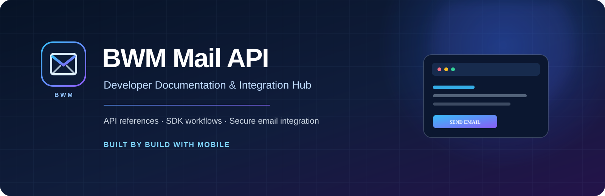

<div align="center">
  
  <br />
  <p><strong>Developer documentation · API references · Integration guides</strong></p>
  <p>
    <a href="https://bwmemailapi.ct.ws/">Website</a> ·
    <a href="https://bwmemailapi.ct.ws/documentation">Documentation</a> ·
    <a href="https://bwmemailapi.ct.ws/api-reference">API Reference</a> ·
    <a href="https://bwmemailapi.ct.ws/integration-guides">Integration Guides</a>
  </p>
  <p>
    
    
    
  </p>
</div>

---

## Overview

**BWM Mail API** is a transactional email API by **[Build With Mobile](https://buildwithmobile.ct.ws/)**. This repository is the developer documentation hub for connecting email workflows to websites, backend services, and application projects.

> **Documentation principle:** The hosted API reference is the source of truth for endpoint paths, methods, authentication, request fields, responses, errors, and account limits. This repository does not guess undocumented API behavior.

## Explore the documentation

| Resource | Description |
|---|---|
| [Getting started](docs/getting-started.md) | Account setup, project creation, API key safety, and first-request checklist |
| [Integration guides](docs/integration-guides.md) | Step-by-step PHP, Node.js, Python, Laravel, webhook, and backend integration guidance |\n| [Code examples](examples/README.md) | Copy-ready cURL, PHP, Node.js, Python, Laravel, and webhook starter files |
| [Security best practices](docs/security.md) | Credential protection and secure account workflows |\n| [Gmail SMTP setup](docs/gmail-smtp-setup.md) | Connect a Gmail account through Own SMTP, with 2-Step Verification and App Password steps |
| [Documentation index](docs/README.md) | All repository guides in one place |
| [Contributing](CONTRIBUTING.md) | Documentation contribution standards |
| [Security policy](SECURITY.md) | How to report a security concern |

## Official product links

<div align="center">

| [🌐 Website](https://bwmemailapi.ct.ws/) | [📘 Docs](https://bwmemailapi.ct.ws/documentation) | [⚡ API Reference](https://bwmemailapi.ct.ws/api-reference) |
|:---:|:---:|:---:|
| [✨ Features](https://bwmemailapi.ct.ws/features) | [💳 Pricing](https://bwmemailapi.ct.ws/pricing) | [🧩 Integrations](https://bwmemailapi.ct.ws/integration-guides) |
| [❓ FAQ](https://bwmemailapi.ct.ws/faq) | [🟢 Service Status](https://bwmemailapi.ct.ws/status) | [✉️ Contact](https://bwmemailapi.ct.ws/contact) |

</div>

## Integration areas

The hosted guides and product documentation cover workflows for:

- **Gmail SMTP** — configure a Gmail account through Own SMTP using a Google App Password.\n- **HTTP / cURL** — test documented API requests directly.
- **PHP** — connect server-side PHP applications.
- **Node.js** — integrate with Node-based backends.
- **Python** — connect Python services and applications.
- **Account email workflows** — OTP, verification, and other supported transactional messages.
- **Webhooks** — implement event handling when enabled and documented for your account.
- **AI coding assistants** — provide official references to ChatGPT, Claude, Gemini, Cursor, Windsurf, or GitHub Copilot.

See the [live integration guide](https://bwmemailapi.ct.ws/integration-guides) for current examples and availability.

## Quick start

1. Visit the [BWM Mail API dashboard](https://bwmemailapi.ct.ws/).
2. Sign in or create an account.
3. Create a project and generate an API key.
4. Read the [getting started guide](docs/getting-started.md).
5. Copy the exact request format from the [API reference](https://bwmemailapi.ct.ws/api-reference).
6. Follow the relevant [integration guide](https://bwmemailapi.ct.ws/integration-guides).
7. Test with a non-production recipient before going live.

### Configure your secret

Keep credentials on your server. Add your key to your deployment environment or secret manager:

```env
BWM_MAIL_API_KEY=YOUR_API_KEY
```

This is an environment-variable example, not an API request. Never commit a real key, expose it in browser JavaScript, include it in a mobile app bundle, or paste it into a public AI prompt.

## Repository structure

```text
BWM-EMAIL-API/
├── assets/
│   └── bwm-mail-api-banner.svg
├── docs/
│   ├── README.md
│   ├── getting-started.md
│   ├── integration-guides.md
│   └── security.md
├── .github/
│   ├── ISSUE_TEMPLATE/
│   │   ├── bug_report.md
│   │   └── feature_request.md
│   └── PULL_REQUEST_TEMPLATE.md
├── CHANGELOG.md
├── CONTRIBUTING.md
├── README.md
└── SECURITY.md
```

## Documentation standards

- Verify every API example against the current hosted API reference.
- Do not invent endpoint paths, parameters, response fields, SDK package names, or pricing.
- Use placeholders such as `YOUR_API_KEY` in all public examples.
- Clearly label features that depend on account configuration.
- Keep guides concise, reproducible, and safe for production use.

## Support

For product and account support, use the [official contact page](https://bwmemailapi.ct.ws/contact). For repository documentation improvements, see [CONTRIBUTING.md](CONTRIBUTING.md).

---

<div align="center">
  <sub>Built with care by <a href="https://buildwithmobile.ct.ws/">Build With Mobile</a> · BWM Mail API</sub>
</div>
